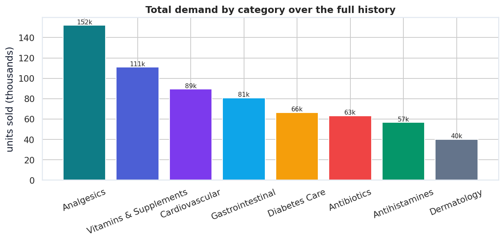
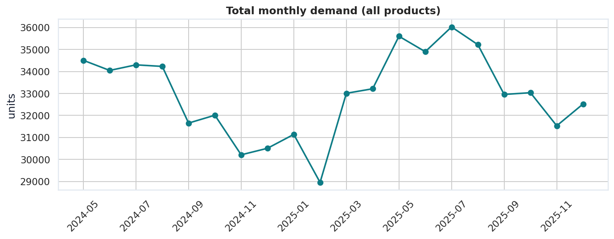
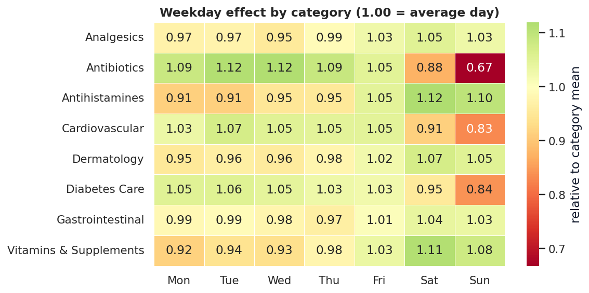
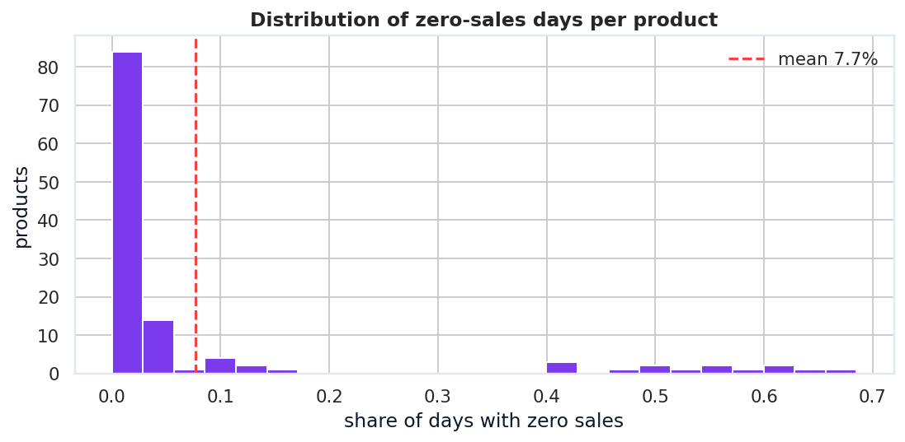
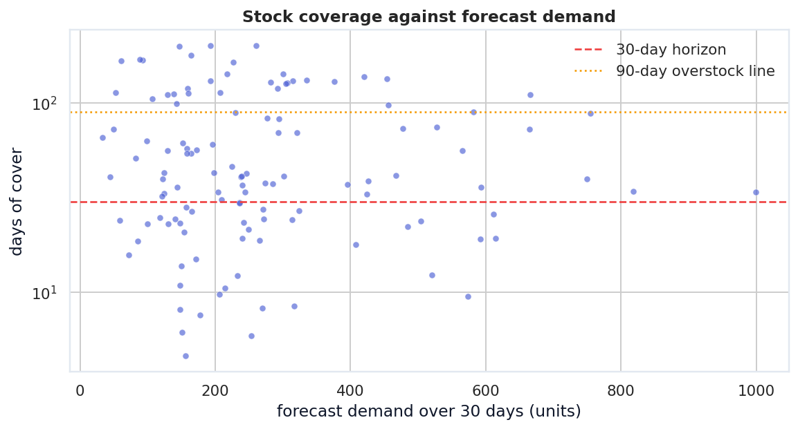
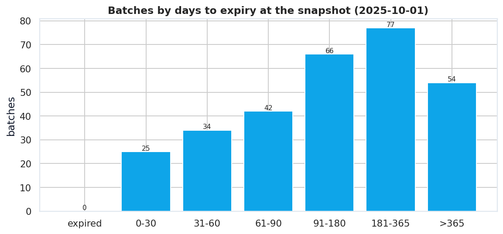
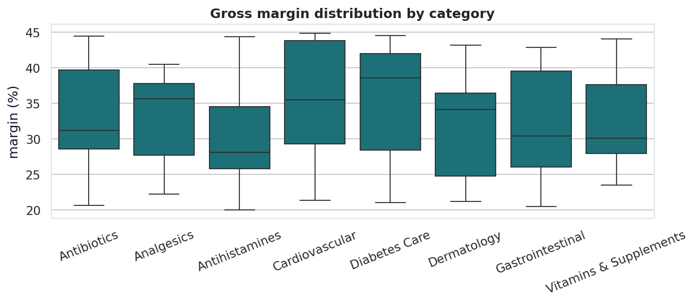
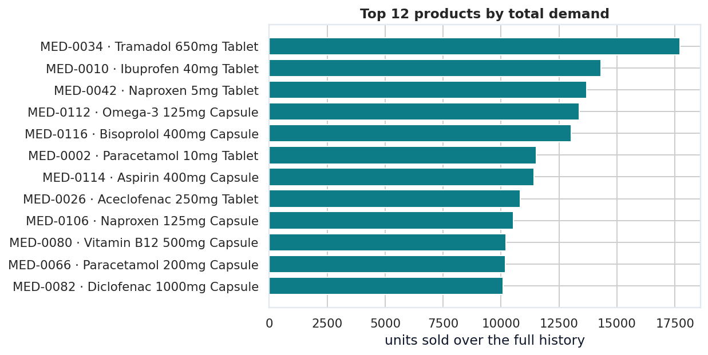

# Exploratory Data Analysis

Generated by `python -m scripts.run_eda` from the *processed* dataset, so every
figure reflects the data the model actually trains on.

> Synthetic data. Patterns below are properties of the simulator, not of a real
> pharmacy. They are reported so the modelling choices can be justified against
> the data-generating process.

## Dataset at a glance

- Products: **120**
- Sales transactions: **67,558**
- Product-days in demand panel: **73,200**
- Batches at snapshot: **298**
- Date range: **2024-05-01 to 2025-12-31**
- Zero-demand share: **7.7%**

## Findings

### 1. Category demand

Analgesics and vitamins dominate volume; dermatology is the smallest category. Category-level baselines in the generator reflect this ordering.

### 2. Monthly seasonality

Clear annual structure: winter peaks (antibiotics, vitamins) and a spring peak (antihistamines). This is why the model needs date-based features rather than a single long-run average.

### 3. Weekday effects

Clinic-driven categories (antibiotics, cardiovascular, diabetes) dip at weekends, while OTC categories (antihistamines, vitamins, dermatology) rise. A single global weekday multiplier would blur this, so the generator applies category profiles.

### 4. Zero-demand structure

Zero-demand days are common (7.7% on average) and heavily skewed: a subset of slow movers is at zero more than half the time. This is why MAPE is unusable and WAPE is the headline metric, and why sparse products carry low-confidence flags in the UI.

### 5. Coverage versus demand

Coverage is uncorrelated with demand size, so neither low-volume nor high-volume products are systematically over- or under-stocked. Both failure modes exist simultaneously, which is exactly the business problem the platform addresses.

### 6. Expiry windows

Roughly a third of batches expire within 90 days, which is the window where forecast-driven rotation advice can still change the outcome. Batches beyond a year are effectively unconstrained by the 30-day forecast.

### 7. Margin distribution

Margins cluster between 20% and 45% with no category-level outliers, so expiry exposure in currency terms tracks unit exposure rather than margin distortion.

### 8. Demand concentration

Demand is concentrated: the top 12 of 120 products account for a disproportionate share of volume, so a small number of forecast errors dominates total cost.

## What this implies for the model

1. **Calendar features matter.** Demand has clear annual and weekly structure, so
   origin month/quarter and demand-history features are justified.
2. **WAPE, not MAPE.** Genuine zero-demand days make percentage error undefined on
   many rows.
3. **Sparse products need honest uncertainty.** Aggregate forecasts for slow movers
   are inherently weak; the UI flags them rather than pretending precision.
4. **Inventory and expiry are decision layers, not demand drivers.** Stock is only
   observed at one date, so it is excluded from the forecasting model (D-011).

## Data-quality problems found

- 46 transactions sell below recorded unit cost. These coincide with promoted days
  and are retained: a pharmacy does sell below list cost during promotions. They are
  reported as a warning in `reports/data_quality_report.json` rather than deleted.
- No duplicate keys, no referential breaks, and batch quantities reconcile exactly
  with on-hand stock (asserted in the test suite).
